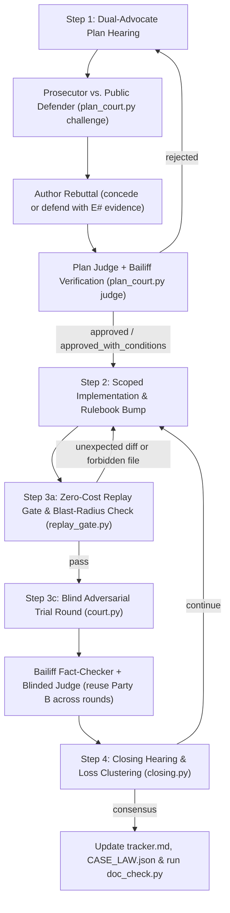

# Agent Courtroom (`agent-courtroom`)

[](https://github.com/krishnanvignesh/agent-courtroom/actions/workflows/ci.yml)
[](https://www.python.org/downloads/)
[](LICENSE)
[](src/courtroom/mcp_server.py)

**Adversarial multi-agent judicial governance framework, CLI, MCP server, and skill for AI coding agents.**

AI coding agents often skip design trade-offs, self-certify unverified edits, silently break out-of-scope files, or drift from architectural decisions across sessions. `agent-courtroom` replaces single-agent self-approval with a structured courtroom lifecycle backed by deterministic verification (**The Bailiff**), hierarchical case law (**Parts 0–3**), and hard USD budget caps.

---

## Core Principles

1. **No Implementation Without an Approved Plan**: Every change (features, refactors, RFCs, pipeline rules, or tooling) starts with a Dual-Advocate Plan Hearing (**Prosecutor** for risk, correctness, and edge cases vs. **Public Defender** for simplicity and YAGNI) followed by a **Judge** verdict before code is written.
2. **Proof, Not Opinion ("The Bailiff")**: Deterministic code (`evidence.py`) checks verbatim source/HTML quotes (`verify_quote`), Python AST symbols & line ranges (`verify_ast_citation`), and recorded command exhibits (`run_command_exhibit`) before any Judge rules. Unverified claims count for nothing.
3. **Hierarchical Living Case Law (`Stare Decisis`)**:
   - **Part 0**: `owner_decisions.md` — append-only, dated Product Owner decisions (supreme authority).
   - **Part 1**: `CASE_LAW.json` & domain-expert decisions — binding court precedents.
   - **Part 2**: `rulebook.json` — `ENABLED` rules are law; `DISABLED` rules are non-binding proposals only.
   - **Part 3**: `conventions.md` — engineering and prompt conventions.
4. **Blind Evaluation & Model Separation**: Production execution stays on your chosen production model while court evaluations run through `CourtClient` with provenance blinding (`blind_payload`) so judges cannot favor `"ours"` / `"production"` over an independent Party B oracle.
5. **Hard Budget Governance**: Every court model call is cached on disk by SHA-256 prompt key, logged to `ledger.json`, and strictly gated by `--budget-usd` (`BudgetExceededError`).

---

## Architecture: The 4-Step Courtroom Lifecycle



---

## Jurisdiction Modes & Built-in Presets

| Mode | Focus | Key Mechanisms | Built-in Preset |
|---|---|---|---|
| `architecture` | System RFCs, service boundaries, data models | Prosecutor vs. Public Defender + `CASE_LAW.json` precedent checks | `arch-default` |
| `software` | Application code, APIs, migrations, test suites | Blast-Radius Contract Gate (`allowed_files` / `forbidden_files`) + Blind Spec-to-Test Trial | `software-default` |
| `pipeline` | Extraction/classification rules over sample corpora | Production vs. Party B oracle trials, zero-cost replay gate, closing loss-clustering | `boe-pipeline` |

---

## Plug-and-Play Setup

### Prerequisites

- Python `3.11+`
- [`uv`](https://docs.astral.sh/uv/) (recommended) or `pip`

```bash
git clone https://github.com/krishnanvignesh/agent-courtroom.git
cd agent-courtroom
uv sync --dev
uv run pytest -v
```

### 1. Antigravity

Render the `SKILL.md` skill into your Antigravity skills directory (global or workspace) and register the MCP server:

```bash
uv run courtroom render-skill --preset software-default --out "$HOME/.gemini/antigravity/skills/courtroom/SKILL.md"
```

Add `agent-courtroom` to your Antigravity MCP config (`mcp_config.json`):

```json
{
  "mcpServers": {
    "agent-courtroom": {
      "command": "uv",
      "args": ["run", "--directory", "/path/to/agent-courtroom", "courtroom", "mcp"]
    }
  }
}
```

### 2. Claude Code

Render the skill into `.claude/skills/courtroom/SKILL.md` in your target project and register the MCP server via the Claude CLI:

```bash
uv run courtroom render-skill --preset software-default --out .claude/skills/courtroom/SKILL.md
claude mcp add courtroom -- uv run --directory /path/to/agent-courtroom courtroom mcp
```

### 3. Cursor

Render the skill as a Cursor rule (`.cursor/rules/courtroom.mdc`) and configure `.cursor/mcp.json`:

```bash
uv run courtroom render-skill --preset software-default --out .cursor/rules/courtroom.mdc
```

`.cursor/mcp.json`:

```json
{
  "mcpServers": {
    "agent-courtroom": {
      "command": "uv",
      "args": ["run", "--directory", "/path/to/agent-courtroom", "courtroom", "mcp"]
    }
  }
}
```

### 4. Any MCP Client (Stdio JSON-RPC 2.0)

`courtroom mcp` implements a zero-dependency stdio JSON-RPC 2.0 MCP server exposing:
`court_verify_evidence`, `court_assemble_law`, `court_challenge`, `court_judge`, `court_replay_gate`, `court_trial_round`, and `court_closing`.

```json
{
  "mcpServers": {
    "agent-courtroom": {
      "command": "uv",
      "args": ["run", "--directory", "/path/to/agent-courtroom", "courtroom", "mcp"]
    }
  }
}
```

---

## CLI Quick Start

### Scaffold a Workspace or Render `SKILL.md`

```bash
# Initialize a project workspace with law/, plans/, tracker.md, and rendered SKILL.md
uv run courtroom init --dir path/to/project --preset software-default

# Render SKILL.md with a specific preset (boe-pipeline, software-default, arch-default)
uv run courtroom render-skill --preset boe-pipeline --out .ai-instructions/skills/boe-courtroom/SKILL.md
```

### Run the 4-Step Courtroom Lifecycle (Sample Workspace)

All standalone scripts from the skill specification live in `tools/courtroom/` and delegate to `src/courtroom/` (and are also available via `courtroom <subcommand>`):

```bash
# Step 1: Dual-advocate Plan Hearing (supports .json, .md, and .yaml plans)
uv run python tools/courtroom/plan_court.py challenge --plan examples/sample_workspace/plans/PLAN-001.json --law-dir examples/sample_workspace/law
uv run python tools/courtroom/plan_court.py judge --plan examples/sample_workspace/plans/PLAN-001.json --rebuttal examples/sample_workspace/plans/PLAN-001.rebuttal.json --law-dir examples/sample_workspace/law

# Step 3a & 3b: Pipeline run + Zero-cost Replay Gate
uv run python tools/courtroom/run_pipeline.py --manifest examples/sample_workspace/manifest.json --law-dir examples/sample_workspace/law --out ours-r1.json
uv run python tools/courtroom/replay_gate.py --baseline examples/sample_workspace/baseline.json --candidate ours-r1.json --expect DOC-001.status=GRANTED --plan examples/sample_workspace/plans/PLAN-001.json --changed-files law/rulebook.json

# Step 3c: Evaluation Court Round + Inspection
uv run python tools/courtroom/court.py --ours ours-r1.json --manifest examples/sample_workspace/manifest.json --law-dir examples/sample_workspace/law --out round-1 --budget-usd 5.0
uv run python tools/courtroom/report.py --round round-1
uv run python tools/courtroom/list_losses.py --round round-1
uv run python tools/courtroom/show_trial.py --round round-1 --id DOC-002

# Step 4: Closing Hearing & Doc Integrity Check
uv run python tools/courtroom/closing.py --round round-1 --brief examples/sample_workspace/BRIEF.json --law-dir examples/sample_workspace/law --tracker examples/sample_workspace/tracker.md --budget-usd 2.0
uv run python tools/courtroom/doc_check.py --skill examples/sample_workspace/SKILL.md --law-dir examples/sample_workspace/law --require-rendered
```

---

## Repository Layout

| Path | Purpose |
|---|---|
| `src/courtroom/` | Core library: Bailiff verification (`evidence.py`), law assembly (`law.py`), `CourtClient` cache/ledger/budget (`opus_client.py`), hearings (`plan_court.py`, `court.py`, `closing.py`), gates (`replay_gate.py`), reporting (`report.py`, `list_losses.py`, `show_title.py`, `show_trial.py`), MCP server (`mcp_server.py`), and CLI (`cli.py`) |
| `tools/courtroom/` | Standalone CLI wrappers matching the `SKILL.md` specification |
| `skills/courtroom/` | Parameterized `SKILL.md` template and presets (`software-default.json`, `arch-default.json`, `boe-pipeline.json`) |
| `examples/sample_workspace/` | End-to-end sample workspace with law files, docs, manifest, plans, and closing brief |
| `tests/` | Offline pytest test suite covering Bailiff evidence, law invariants, budget caps, trials, replay gates, doc checks, and MCP JSON-RPC |

---

## Contributing & Security

- See [CONTRIBUTING.md](CONTRIBUTING.md) for development setup, testing, and courtroom governance conventions.
- See [CHANGELOG.md](CHANGELOG.md) for release history.
- See [SECURITY.md](SECURITY.md) for built-in security controls and vulnerability reporting.
- Licensed under the [MIT License](LICENSE).
