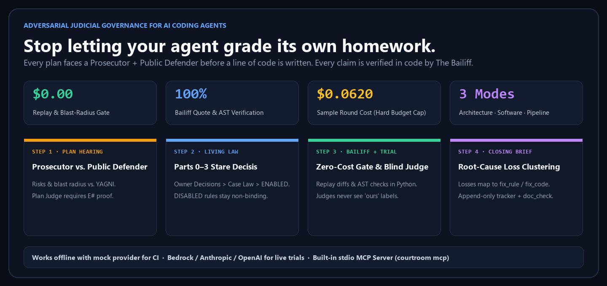
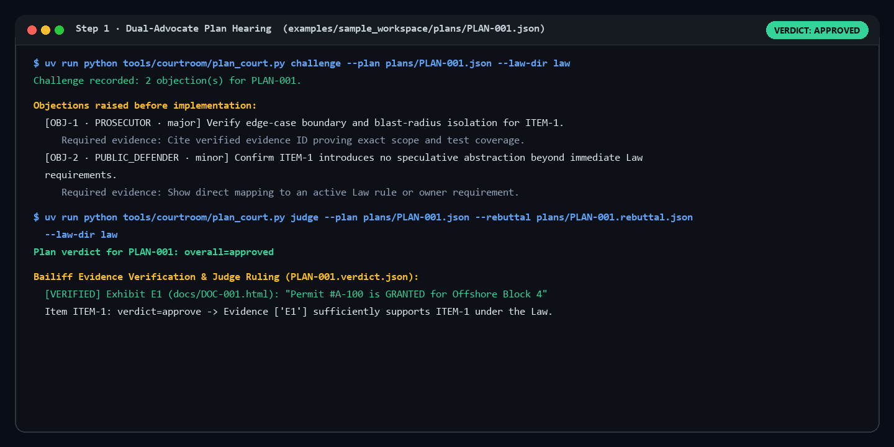
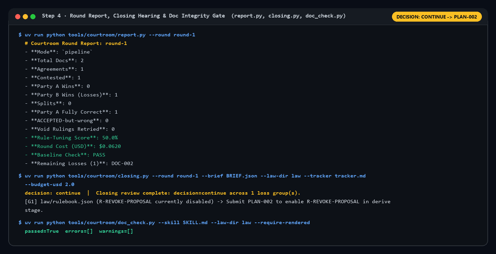

<h1 align="center">Courtroom</h1>

<p align="center">
  <em>Stop letting your AI coding agent grade its own homework. Put it on trial.</em>
</p>

<p align="center">
  <a href="https://github.com/krishnanvignesh/courtroom/actions/workflows/ci.yml"></a>
  
  
  
  
</p>

<p align="center">
  
</p>

**Courtroom (`agent-courtroom`)** is an adversarial multi-agent judicial governance framework, CLI, stdio MCP server, and agent skill across three jurisdiction modes (`architecture`, `software`, and `pipeline`).

AI coding agents love to write a plan, write the code, write the test, and announce *"Everything verified!"* in a single optimistic loop. Courtroom replaces self-certification with an adversarial court process backed by deterministic Python verification (**The Bailiff**), hierarchical living case law (**Parts 0–3**), provenance-blinded judges, and hard USD budget caps.

---

## Why Courtroom? (And Why a Single Persona Prompt Isn't Enough)

Single-persona coding skills nudge an agent's tone (for example, *"be minimal"* or *"act like a senior dev"*). **Tone is not governance.** Under pressure, a single persona still hallucinates citations, drifts outside the approved blast radius, treats draft rules as active law, or rationalizes its own output as correct.

Courtroom separates **advocacy**, **fact-checking**, and **judgment**:

- **The Prosecutor** attacks failure modes, concurrency races, security hazards, migration risks, and unpredicted blast radius.
- **The Public Defender (YAGNI & Simplicity Counsel)** attacks speculative abstractions, premature optimization, redundant dependencies, and scope creep beyond the Law.
- **The Bailiff (`evidence.py`)** never trusts LLM prose—it verifies verbatim HTML/text quotes, Python AST symbols & line ranges, and SHA-256 command exhibits deterministically in code before any judge rules.
- **The Blinded Judge (`opus_client.py`)** evaluates submissions with provenance neutralized (`"Submission A"` vs. `"Submission B"`) so production output gets zero home-court advantage.

<p align="center">
  
</p>

| Agent Failure Mode | What Goes Wrong Without Governance | How Courtroom Enforces It in Code |
|---|---|---|
| **Self-certified plans** | Agent skips edge cases or over-engineers abstractions unchecked | `plan_court.py` runs Prosecutor + Public Defender before implementation; Judge requires verified `E#` proof |
| **Hallucinated quotes & symbols** | Claims `"file X handles Y"` or misquotes a spec/document | `evidence.verify_quote` & `evidence.verify_ast_citation` mark unbacked claims `UNVERIFIED`; Judge ignores them |
| **Silent blast-radius creep** | Fixing one bug breaks untouched modules or edits protected policy files | `replay_gate.py` enforces `allowed_files`, `forbidden_files`, and fails immediately on any unpredicted diff (`$0.00` cost) |
| **Rule drift & forgotten decisions** | Old owner rulings get edited or draft proposals leak into prod behavior | Hierarchical Parts 0–3 Law (`law.py`): append-only `owner_decisions.md`, `CASE_LAW.json`, `ENABLED` rules only |
| **Judge self-preference & spend spikes** | Judges favor `"ours"` and retry uncached LLM calls indefinitely | `blind_payload` strips provenance; `CourtClient` disk-caches by SHA-256 and raises `BudgetExceededError` |

---

## End-to-End Local Walkthrough (Captured From Live Run)

Everything below comes directly from running the 4-step lifecycle locally on [`examples/sample_workspace/`](examples/sample_workspace/).

**The Scenario in `examples/sample_workspace/`**:
- Two regulatory notice documents sit in the corpus:
  - [`DOC-001.html`](examples/sample_workspace/docs/DOC-001.html): *"Notice 2026-10: Permit #A-100 is **GRANTED** for Offshore Block 4."*
  - [`DOC-002.html`](examples/sample_workspace/docs/DOC-002.html): *"Notice 2026-11: Application #B-202 is **REVOKED** due to expired bond."*
- Part 0 Owner Decision [`OD-1`](examples/sample_workspace/law/owner_decisions.md) states: *"Production output must never publish a status contradicted by the verbatim source notice."*
- Part 1 Precedent [`PREC-001`](examples/sample_workspace/law/CASE_LAW.json) holds: *"Explicit GRANTED dispositions override generic notice defaults."*
- Part 2 [`rulebook.json`](examples/sample_workspace/law/rulebook.json) (`v0.2.0`) has `R-NOTICE-DEFAULT` (`enabled: true`), `R-GRANT` (`enabled: true`), and `R-REVOKE-PROPOSAL` (`enabled: false` — a proposed rule that is **not** active law yet).

### Step 1: Dual-Advocate Plan Hearing (`plan_court.py`)

Before touching code or rules, we submit [`PLAN-001.json`](examples/sample_workspace/plans/PLAN-001.json) (which declares `blast_radius.allowed_files: ["law/rulebook.json"]`, `forbidden_files: ["law/owner_decisions.md"]`, and `expected_deltas: {"DOC-001.status": "GRANTED"}`) alongside verbatim exhibit `E1` from `docs/DOC-001.html`.

Both **Prosecutor (`OBJ-1`)** and **Public Defender (`OBJ-2`)** challenge `ITEM-1`. We answer both objections in [`PLAN-001.rebuttal.json`](examples/sample_workspace/plans/PLAN-001.rebuttal.json), The Bailiff verifies Exhibit `E1`, and the Plan Judge issues `overall=approved`.

<p align="center">
  
</p>

### Step 2: Scoped Implementation & Living Case Law (`law/`)

Once approved, only the scoped change is applied (`R-GRANT` enabled in `law/rulebook.json`, bumped to `0.2.0` with matching changelog entry).

Courtroom assembles **Parts 0–3 Law** (`law.assemble_law`) in strict precedence order:
1. **Part 0 — `owner_decisions.md`**: Dated `## YYYY-MM-DD | OD-N` blocks. **Strictly append-only**—modifying or deleting an earlier decision fails `doc_check.py` and `validate_owner_decisions_append_only`.
2. **Part 1 — `CASE_LAW.json`**: Binding court precedents decided under owner delegation (`"decided by the court under OD-1"`).
3. **Part 2 — `rulebook.json`**: Only `enabled: true` rules enter active law. `R-REVOKE-PROPOSAL` (`enabled: false`) is kept strictly segregated under *DISABLED PROPOSALS — NOT LAW*.
4. **Part 3 — `conventions.md`**: Engineering & formatting conventions (e.g., *"Format only the files you change"*).

### Step 3: Zero-Cost Replay Gate & Blind Adversarial Trial (`replay_gate.py` & `court.py`)

Next we run `run_pipeline.py` to generate candidate output (`ours-r1.json`) and check it with **`replay_gate.py` at $0.00 LLM cost**:
- `DOC-001.status` transitioned `PENDING -> GRANTED` as predicted.
- `unpredicted_diffs=[]` and `blast_radius_violations=[]` (`law/rulebook.json` is inside `allowed_files`).

Then **`court.py`** runs an evaluation trial across all documents against an independent **Party B** oracle (total sample round cost: **`$0.0620`**):
- On `DOC-001`, Party A and Party B both agree on `GRANTED` (zero judge calls needed).
- On `DOC-002`, Party A falls back to `PENDING` (because `R-REVOKE-PROPOSAL` is still disabled) while Party B outputs `REVOKED`. Advocate A and Advocate B present openings & rebuttals, **The Bailiff** verifies exact normalized text offsets (`offset 0` and `offset 38`), and the **Blinded Trial Judge** awards `DOC-002` to Party B citing verified decisive quote `"REVOKED due to expired bond."`.

<p align="center">
  
</p>

### Step 4: Round Report, Closing Hearing & Doc Integrity (`closing.py` & `doc_check.py`)

Rather than ignoring `DOC-002` or hot-patching disabled rules without a hearing, every remaining loss is grouped in [`BRIEF.json`](examples/sample_workspace/BRIEF.json) (each loss appears in **exactly one** group) and sent to **`closing.py`**:
- `report.py` summarizes: `1 Agreement`, `1 Contested`, `ACCEPTED-but-wrong: 0`, `Rule-Tuning Score: 50.0%`, `Round Cost: $0.0620`, `Baseline Check: PASS`.
- `closing.py` reviews Group `G1` (`DOC-002`) and returns `decision: continue` with action: *"Submit PLAN-002 to enable R-REVOKE-PROPOSAL in derive stage."*
- `doc_check.py --require-rendered` confirms `SKILL.md` structure, zero unresolved `{{PLACEHOLDER}}` tokens, append-only `owner_decisions.md`, and `rulebook.json` version/changelog sync (`passed=True`).

<p align="center">
   PLAN-002, and doc_check passed=True.">
</p>

---

## Under the Hood: 4 Details Worth Knowing

### 1. How The Bailiff Catches Hallucinations (`src/courtroom/evidence.py`)
- **HTML & Text Quotes (`verify_quote`)**: Strips HTML tags, unescapes HTML entities, collapses whitespace, enforces a 4-character minimum normalized length, and verifies exact substring presence plus match offset.
- **Python AST & Line Ranges (`verify_ast_citation`)**: Resolves paths safely inside `repo_root` (`candidate.relative_to(root)` prevents `../` traversal), validates `L10-L25` bounds against actual file line counts, or parses Python ASTs to verify dotted symbols (`ClassName.method_name` or top-level variables/functions) and their exact `lineno`–`end_lineno` range.
- **Command Exhibits (`run_command_exhibit`)**: Executes bounded commands (`timeout=30` default) and records exit code plus a SHA-256 digest (`output_sha256`).
- If the Trial Judge rules with an `UNVERIFIED` or missing `decisive_quote` (and advocates haven't conceded), `court.py` flags it as a **void ruling** and retries once with explicit Bailiff feedback.

### 2. How Judge Provenance Blinding Works (`blind_payload` in `src/courtroom/opus_client.py`)
Before sending prompts to `plan_judge`, `trial_judge`, or `closing_judge`, `CourtClient` runs `blind_payload()` to neutralize provenance bias:
- `"Party A (production)"` -> `"Submission A"`
- `"Party B (independent)"` -> `"Submission B"`
- `"ours (production)"` / `"production output"` -> `"Submission A"`
- `"ours_a"` / `"ours"` -> `"submission_a"`

Judges rule strictly on verified evidence and active Law, never on which pipeline produced the answer.

### 3. How Party B Reuse & Budget Caps Keep Costs Predictable (`court.py` & `opus_client.py`)
- **Disk Cache & Ledger**: Every model call is keyed by SHA-256 of `(model, role, schema_name, system_prompt, user_prompt)` and cached on disk; spend is recorded in `ledger.json`. Cache hits cost `$0.00`.
- **Hard Budget Cap (`--budget-usd`)**: Before every uncached model call, `CourtClient` checks `current_spend() + estimate_cost(...) > budget_usd` and raises `BudgetExceededError` before spending a cent over budget.
- **Cross-Round Reuse (`--reuse-b` & `--previous-round`)**: In Round 2+, pass `--reuse-b round-1` to reuse Party B outputs across unchanged docs, and `--previous-round round-1` to skip re-judging trials where Party A's output didn't change (unless you file an appeal via `--appeals`).

### 4. Three Jurisdiction Modes (`architecture`, `software`, `pipeline`)
Courtroom isn't tied to extraction pipelines—the same 4-step engine governs three modes:

| Mode | What Party A Submits | What Party B Produces | Key Gate | Built-in Preset |
|---|---|---|---|---|
| `architecture` | System RFC, boundaries, data models | Independent architecture critique | Prosecutor vs. Public Defender + `CASE_LAW.json` | `arch-default` |
| `software` | Application code, APIs, tests | Blind spec-to-test assertions generated solely from `PLAN-NNN` + Law | `allowed_files` / `forbidden_files` Blast-Radius Gate | `software-default` |
| `pipeline` | Corpus outputs (`ours-rN.json`) | Independent oracle extraction across corpus samples | Zero-cost `replay_gate.py` diff check + loss clustering | `boe-pipeline` |

---

## Plug-and-Play Setup

### Prerequisites

- Python `3.11+`
- [`uv`](https://docs.astral.sh/uv/) (recommended) or `pip`

```bash
git clone https://github.com/krishnanvignesh/courtroom.git
cd courtroom
uv sync --dev
uv run pytest -v
```

### 1. Antigravity

Render the `SKILL.md` skill into your Antigravity skills directory (global or workspace) and register the MCP server:

```bash
uv run courtroom render-skill --preset software-default --out "$HOME/.gemini/antigravity/skills/courtroom/SKILL.md"
```

Add `courtroom` to your Antigravity MCP config (`mcp_config.json`):

```json
{
  "mcpServers": {
    "courtroom": {
      "command": "uv",
      "args": ["run", "--directory", "/path/to/courtroom", "courtroom", "mcp"]
    }
  }
}
```

### 2. Claude Code

Render the skill into `.claude/skills/courtroom/SKILL.md` in your target project and register the MCP server:

```bash
uv run courtroom render-skill --preset software-default --out .claude/skills/courtroom/SKILL.md
claude mcp add courtroom -- uv run --directory /path/to/courtroom courtroom mcp
```

### 3. Cursor

Render the skill as a Cursor rule (`.cursor/rules/courtroom.mdc`) and configure `.cursor/mcp.json`:

```bash
uv run courtroom render-skill --preset software-default --out .cursor/rules/courtroom.mdc
```

`.cursor/mcp.json`:

```json
{
  "mcpServers": {
    "courtroom": {
      "command": "uv",
      "args": ["run", "--directory", "/path/to/courtroom", "courtroom", "mcp"]
    }
  }
}
```

### 4. Any MCP Client (Codex, Windsurf, Cline, Custom Agents)

`courtroom mcp` runs a zero-dependency stdio JSON-RPC 2.0 MCP server exposing 7 tools:
`court_verify_evidence`, `court_assemble_law`, `court_challenge`, `court_judge`, `court_replay_gate`, `court_trial_round`, and `court_closing`.

```json
{
  "mcpServers": {
    "courtroom": {
      "command": "uv",
      "args": ["run", "--directory", "/path/to/courtroom", "courtroom", "mcp"]
    }
  }
}
```

---

## CLI & Standalone Scripts Quick Start

### Initialize a Governed Workspace

```bash
# Scaffold law/, plans/, tracker.md, and a rendered SKILL.md
uv run courtroom init --dir path/to/project --preset software-default

# Or render SKILL.md with custom placeholders or preset (software-default | arch-default | boe-pipeline)
uv run courtroom render-skill --preset arch-default --out .ai-instructions/skills/arch-courtroom/SKILL.md
```

### Reproduce the Full Sample Walkthrough Locally

```bash
# Step 1: Dual-advocate Plan Hearing (supports .json, .md, and .yaml plans)
uv run python tools/courtroom/plan_court.py challenge --plan examples/sample_workspace/plans/PLAN-001.json --law-dir examples/sample_workspace/law
uv run python tools/courtroom/plan_court.py judge --plan examples/sample_workspace/plans/PLAN-001.json --rebuttal examples/sample_workspace/plans/PLAN-001.rebuttal.json --law-dir examples/sample_workspace/law

# Step 3a & 3b: Pipeline run + Zero-cost Replay & Blast-Radius Gate
uv run python tools/courtroom/run_pipeline.py --manifest examples/sample_workspace/manifest.json --law-dir examples/sample_workspace/law --out ours-r1.json
uv run python tools/courtroom/replay_gate.py --baseline examples/sample_workspace/baseline.json --candidate ours-r1.json --expect DOC-001.status=GRANTED --plan examples/sample_workspace/plans/PLAN-001.json --changed-files law/rulebook.json

# Step 3c: Evaluation Court Round + Inspection
uv run python tools/courtroom/court.py --ours ours-r1.json --manifest examples/sample_workspace/manifest.json --law-dir examples/sample_workspace/law --out round-1 --budget-usd 5.0
uv run python tools/courtroom/report.py --round round-1
uv run python tools/courtroom/list_losses.py --round round-1
uv run python tools/courtroom/show_trial.py --round round-1 --id DOC-002

# Step 4: Closing Hearing & Doc Integrity Check
uv run python tools/courtroom/closing.py --round round-1 --brief examples/sample_workspace/BRIEF.json --law-dir examples/sample_workspace/law --tracker examples/sample_workspace/tracker.md --budget-usd 2.0
uv run python tools/courtroom/doc_check.py --skill examples/sample_workspace/SKILL.md --law-dir examples/sample_workspace/law --require-rendered
```

---

## Repository Layout

| Path | Purpose |
|---|---|
| [`src/courtroom/`](src/courtroom/) | Core library: Bailiff (`evidence.py`), Law assembly (`law.py`), `CourtClient` cache/ledger/budget/blinding (`opus_client.py`), Hearings (`plan_court.py`, `court.py`, `closing.py`), Replay & blast-radius gate (`replay_gate.py`), Reporting (`report.py`, `list_losses.py`, `show_title.py`, `show_trial.py`), Markdown compiler (`markdown_compiler.py`), MCP server (`mcp_server.py`), and CLI (`cli.py`) |
| [`tools/courtroom/`](tools/courtroom/) | Standalone CLI wrappers matching the `SKILL.md` specification |
| [`skills/courtroom/`](skills/courtroom/) | Parameterized `SKILL.md` template and presets (`software-default.json`, `arch-default.json`, `boe-pipeline.json`) |
| [`examples/sample_workspace/`](examples/sample_workspace/) | End-to-end sample workspace used in the walkthrough above |
| [`assets/`](assets/) | Visual architecture cards and local CLI capture screenshots |
| [`tests/`](tests/) | Offline pytest test suite covering Bailiff verification, law invariants, budget caps, trials, replay gates, doc checks, and MCP JSON-RPC |

---

## FAQ

**Do I need live API keys just to try it or run CI?**
No. Every CLI command and all tests default to `--provider mock`, so you can run plan hearings, replay gates, blind trial rounds, closing briefs, and CI completely offline at `$0.00`. Switch to `--provider bedrock`, `anthropic`, or `openai` (with optional extras `.[bedrock]`, `.[anthropic]`, `.[openai]`) for live model trials.

**Can I write plans in Markdown instead of JSON?**
Yes. `plan_court.py` uses `markdown_compiler.py` to compile `.md` or `.yaml` plans and rebuttals into validated structured JSON automatically.

**How does Courtroom relate to single-persona skills like Ponytail?**
Single-persona prompts optimize *coding style* (minimalism, cutting bloat). Courtroom enforces *engineering governance*—pit Prosecutor (risk/correctness) against Public Defender (YAGNI), verify every quote/AST reference in Python, gate file blast radius at `$0.00`, and preserve append-only case law across sessions. You can even pair minimal coding style conventions inside Part 3 `conventions.md` with Courtroom's adversarial gates.

---

## Contributing, Security & License

- [CONTRIBUTING.md](CONTRIBUTING.md) — Development setup, offline tests, and governance conventions
- [CHANGELOG.md](CHANGELOG.md) — Release history (`v0.1.0`)
- [SECURITY.md](SECURITY.md) — Path confinement, blinding, budget guardrails, and vulnerability reporting
- [LICENSE](LICENSE) — MIT License
