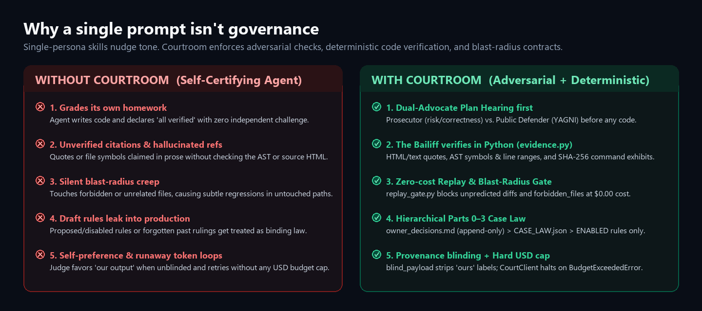

<h1 align="center">⚖️ Courtroom</h1>

<p align="center">
  <strong>Stop letting your AI coding agent grade its own homework.</strong><br>
  An adversarial review layer for Claude Code, Antigravity, Cursor, Codex, and any MCP agent.
</p>

<p align="center">
  <a href="https://github.com/krishnanvignesh/courtroom/actions/workflows/ci.yml"></a>
  
  
  
  
</p>

<p align="center">
  <a href="https://krishnanvignesh.github.io/courtroom/"><strong>🌐 Website</strong></a> ·
  <a href="#-quick-start-2-minutes"><strong>🚀 Quick Start</strong></a> ·
  <a href="docs/HOW_IT_WORKS.md"><strong>📖 How It Works (Deep Dive)</strong></a>
</p>

<p align="center">
  
</p>

---

## The problem

On a small script, your AI agent is great. On anything **complex** — a multi-service backend, a production web app, a data pipeline, an architecture change — it starts to:

- ✅ say *"all tests pass, everything verified!"* about its own work
- 📄 cite files, functions, or docs that don't say what it claims
- 💥 fix one bug and quietly edit five files it shouldn't touch
- 🧠 forget decisions you made last week
- 🏗️ add abstractions nobody asked for

A better prompt doesn't fix this. **A second opinion that can't be talked into agreeing does.**

## The solution

Courtroom runs every meaningful change through a short trial before and after it's built:

| | Role | What it does |
|---|---|---|
| 🔴 | **Prosecutor** | Hunts for bugs, security holes, race conditions, and side effects |
| 🔵 | **Public Defender** | Pushes back on over-engineering and scope creep |
| 🟢 | **The Bailiff** | Plain Python, no AI. Checks that every quote, function, and line reference actually exists |
| 🟣 | **Blinded Judge** | Decides on verified evidence only, without knowing whose work is whose |
| 📜 | **Living Law** | Your decisions, saved in the repo, so the agent remembers them next session |

```
 Plan ──► Prosecutor vs Defender ──► Judge approves ──► Build ──► $0 diff gate ──► Blind trial ──► Done
            (before any code)                                    (catches surprises)  (verifies results)
```

<p align="center">
  
</p>

---

## 🚀 Quick start (2 minutes)

**You need:** Python 3.11+ and [`uv`](https://docs.astral.sh/uv/getting-started/installation/).

**1. Install**

```bash
git clone https://github.com/krishnanvignesh/courtroom.git
cd courtroom
uv sync
```

**2. Add it to your agent** (pick one)

<details open>
<summary><b>Claude Code</b></summary>

```bash
uv run courtroom render-skill --preset software-default --out /path/to/your-project/.claude/skills/courtroom/SKILL.md
claude mcp add courtroom -- uv run --directory /path/to/courtroom courtroom mcp
```
</details>

<details>
<summary><b>Antigravity</b></summary>

```bash
uv run courtroom render-skill --preset software-default --out ~/.gemini/antigravity/skills/courtroom/SKILL.md
```
Then add the MCP block below to your `mcp_config.json`.
</details>

<details>
<summary><b>Cursor</b></summary>

```bash
uv run courtroom render-skill --preset software-default --out /path/to/your-project/.cursor/rules/courtroom.mdc
```
Then add the MCP block below to `.cursor/mcp.json`.
</details>

<details>
<summary><b>Codex, Windsurf, Cline, or any MCP client</b></summary>

Add the MCP block below to your client's MCP config.
</details>

```json
{
  "mcpServers": {
    "courtroom": {
      "command": "uv",
      "args": ["run", "--directory", "/path/to/courtroom", "courtroom", "mcp"]
    }
  }
}
```

**3. Set up your project**

```bash
uv run courtroom init --dir /path/to/your-project --preset software-default
```

That's it. Ask your agent for a change and it will plan it, put the plan through review, and verify the result before calling it done.

> 💡 **No API key needed to try it.** Everything runs offline in mock mode at `$0.00`. Add `--provider anthropic`, `openai`, or `bedrock` when you want real model reviews.

### Choose a preset

| Preset | Use it for |
|---|---|
| `software-default` | Backend services, APIs, **web apps**, refactors, migrations |
| `arch-default` | Design docs, RFCs, service boundaries, data models |
| `boe-pipeline` | Data extraction / classification pipelines checked against a sample set |

---

## Where it helps

| You're building… | Without Courtroom | With Courtroom |
|---|---|---|
| **A backend API** | Agent adds rate limiting and also edits billing code | Plan declares the allowed files; any edit outside them **fails the gate** |
| **A web app** | "Refactor the checkout form" also breaks the auth flow | Independent tests are written from the spec alone, so they can't just match the implementation |
| **An architecture change** | Agent proposes Kafka + 3 new services for 50 events/day | Public Defender asks for evidence the scale is real, and a simpler design wins |
| **A data pipeline** | Agent says the new rule "works", but 1 in 10 records is wrong | Each disagreement goes to a blind trial with a verified source quote |

👉 See full worked examples on the **[website](https://krishnanvignesh.github.io/courtroom/#cases)**.

---

## See it run

Try the included example, no setup or API keys needed:

```bash
uv run courtroom plan challenge --plan examples/sample_workspace/plans/PLAN-001.json --law-dir examples/sample_workspace/law
uv run courtroom plan judge --plan examples/sample_workspace/plans/PLAN-001.json --rebuttal examples/sample_workspace/plans/PLAN-001.rebuttal.json --law-dir examples/sample_workspace/law
```

<p align="center">
  
</p>

For the full four-step walkthrough, see **[How It Works](docs/HOW_IT_WORKS.md#10-end-to-end-walkthrough-real-output)**.

---

## Why trust it?

- **Facts are checked in code, not by AI.** If a quote or function doesn't exist, the claim is thrown out.
- **Cheap checks run first.** The diff and file-scope gate costs `$0.00` and runs before any paid review.
- **Hard spending cap.** Every model call is cached and logged, and the run stops *before* it goes over `--budget-usd`.
- **Everything is a file in your repo.** Plans, verdicts, and decisions are plain JSON/Markdown you can review in a PR.
- **Tested.** CI runs on Linux and Windows across Python 3.11–3.13.

---

## Learn more

| | |
|---|---|
| 🌐 **[Website](https://krishnanvignesh.github.io/courtroom/)** | Visual overview, architecture, and examples |
| 📖 **[How It Works](docs/HOW_IT_WORKS.md)** | Every role, gate, file format, CLI command, and MCP tool |
| 🤝 **[Contributing](CONTRIBUTING.md)** | Dev setup and conventions |
| 🔒 **[Security](SECURITY.md)** | Path confinement, blinding, budget guardrails |
| 📝 **[Changelog](CHANGELOG.md)** | Release history |

<p align="center"><sub>MIT Licensed · If Courtroom saves you from one bad merge, consider giving it a ⭐</sub></p>
