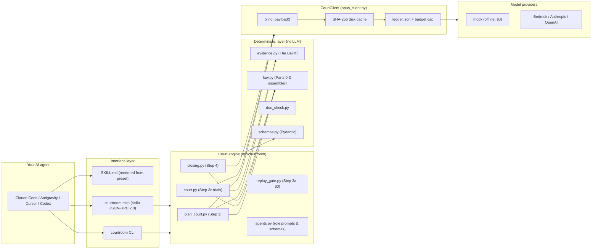
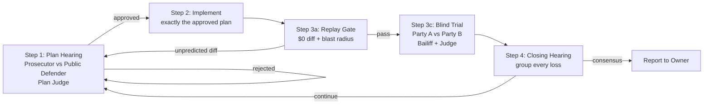
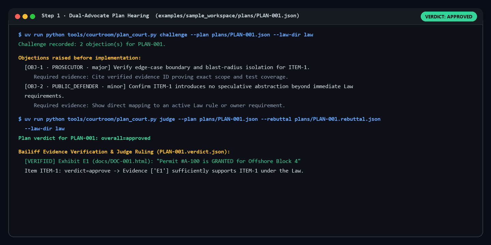
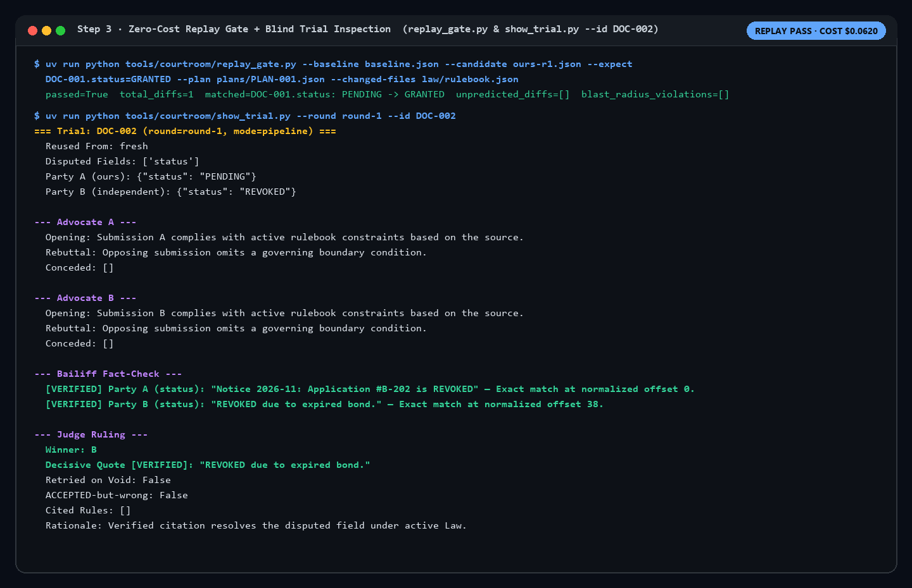
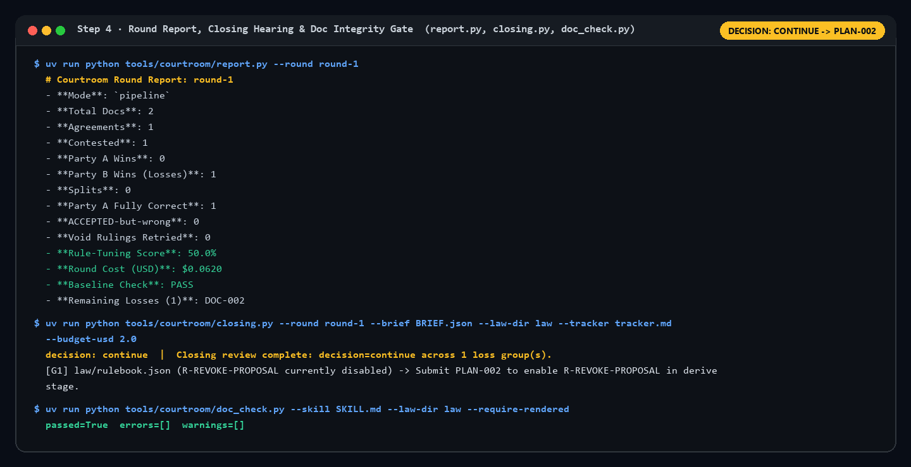

# How Courtroom Works — Deep Dive

> **Looking for the quick version?** Head back to the [main README](../README.md) or the [project website](https://krishnanvignesh.github.io/courtroom/).
> This document is for people who want to understand *exactly* what happens under the hood: every role, every gate, every file.

---

## Contents

1. [The core idea](#1-the-core-idea)
2. [Architecture](#2-architecture)
3. [The cast: who does what](#3-the-cast-who-does-what)
4. [The 4-step lifecycle](#4-the-4-step-lifecycle)
5. [Living Law (Parts 0–3)](#5-living-law-parts-03)
6. [The Bailiff: deterministic evidence verification](#6-the-bailiff-deterministic-evidence-verification)
7. [Judge provenance blinding](#7-judge-provenance-blinding)
8. [Cost control: cache, ledger, budget caps, reuse](#8-cost-control-cache-ledger-budget-caps-reuse)
9. [Jurisdiction modes](#9-jurisdiction-modes)
10. [End-to-end walkthrough (real output)](#10-end-to-end-walkthrough-real-output)
11. [Plan file format](#11-plan-file-format)
12. [CLI reference](#12-cli-reference)
13. [MCP server reference](#13-mcp-server-reference)
14. [Editor / agent integration details](#14-editor--agent-integration-details)
15. [Repository layout](#15-repository-layout)
16. [FAQ](#16-faq)

---

## 1. The core idea

AI coding agents tend to write a plan, write the code, write the test, and announce *"Everything verified!"* in one optimistic loop. The same model that produced the work is grading the work.

Courtroom replaces that self-certification with an **adversarial process** in which advocacy, fact-checking, and judgment are separate:

| Concern | Who handles it | Trusts LLM prose? |
|---|---|---|
| Finding risks | **Prosecutor** (LLM) | — |
| Fighting over-engineering | **Public Defender** (LLM) | — |
| Checking facts | **The Bailiff** (`evidence.py`, pure Python) | **Never** |
| Gating file changes | **Replay Gate** (`replay_gate.py`, pure Python) | **Never** |
| Deciding | **Blinded Judge** (LLM, provenance-neutralized) | Only verified evidence |
| Memory across sessions | **Living Law** (`law/` files, append-only rules) | — |
| Spend | **CourtClient** (`opus_client.py`) cache + ledger + hard cap | — |

**Tone is not governance.** A persona prompt ("act like a senior engineer") still hallucinates citations under pressure. Courtroom puts the critical checks in deterministic code.

---

## 2. Architecture



**Key design choices**

- **The LLM never has the last word on facts.** Every quote, AST symbol, line range, and command exhibit is checked in Python before a judge sees it. Unverified claims are labelled `UNVERIFIED` and ignored.
- **Cheap checks run first.** The replay gate costs `$0.00` and fails fast on unpredicted diffs before any paid trial runs.
- **State lives in plain files.** Plans, verdicts, law, and rounds are JSON/Markdown in your repo, so they are reviewable in PRs and survive across agent sessions.
- **Provider-agnostic.** `--provider mock` (default) runs fully offline; `bedrock`, `anthropic`, or `openai` for live runs.

---

## 3. The cast: who does what

| Role | Implemented in | Job |
|---|---|---|
| **Prosecutor** | `agents.py` → `plan_court.py` | Attacks failure modes, races, security hazards, migration risks, unpredicted blast radius. |
| **Public Defender** (YAGNI & Simplicity Counsel) | `agents.py` → `plan_court.py` | Attacks speculative abstractions, premature optimization, redundant dependencies, scope creep. |
| **Plan Judge** | `agents.py` → `plan_court.py judge` | Rules per plan item (`approve` / `approve_with_conditions` / `reject`) using only verified `E#` evidence. |
| **Party B (Generator)** | `court.py` | Produces an independent output (pipeline), independent critique (architecture), or blind spec-to-test assertions (software). |
| **Advocates A & B** | `court.py` | Opening, rebuttal, optional concessions on each contested item. |
| **The Bailiff** | `evidence.py` | Deterministically marks every citation `VERIFIED` / `UNVERIFIED`. |
| **Trial Judge** (blinded) | `court.py` | Must cite a verified `decisive_quote`; void rulings are retried once. |
| **Closing Judge** | `closing.py` | Reviews grouped losses; returns `continue` (with required fixes) or `consensus`. |
| **Owner** (you) | `law/owner_decisions.md` | Supreme authority. Append-only decisions override everything. |

---

## 4. The 4-step lifecycle



| Step | Command | Output | Gate |
|---|---|---|---|
| 1. Plan hearing | `plan_court.py challenge` → `plan_court.py judge` | `PLAN-NNN.challenge.json`, `PLAN-NNN.verdict.json` | No code until `overall: approved` |
| 2. Implement | (your agent) | Code / rule changes + rulebook version bump | Only what the plan says |
| 3a. Replay gate | `replay_gate.py` | pass/fail, diffs, blast-radius violations | Any unpredicted diff fails. `$0.00` |
| 3b. Pipeline run | `run_pipeline.py` | `ours-rN.json` | — |
| 3c. Trial round | `court.py` | `round-N/` trials, report | Standing success baseline |
| 4. Closing | `closing.py` | closing verdict, tracker update | Every loss in exactly one group |

**Standing success baseline** (each round must satisfy):
`party_a_fully_correct >= previous_round`, `accepted_but_wrong == 0`, `rule_tuning_score >= previous_round`.

---

## 5. Living Law (Parts 0–3)

`law.assemble_law()` builds the active law in strict precedence order:

| Part | File | Rules |
|---|---|---|
| **0 — Owner decisions** | `owner_decisions.md` | Dated `## YYYY-MM-DD \| OD-N` blocks. **Append-only** — editing or deleting an earlier entry fails `doc_check.py` and `validate_owner_decisions_append_only`. New decisions supersede old ones without rewriting them. |
| **1 — Case law** | `CASE_LAW.json` | Binding precedents decided by the court under owner delegation (`"decided by the court under OD-1"`). Holdings stay narrow. |
| **2 — Rulebook** | `rulebook.json` | Only `enabled: true` rules are law. Disabled rules are listed separately under *DISABLED PROPOSALS — NOT LAW*. Version and changelog must stay in sync. |
| **3 — Conventions** | `conventions.md` | Engineering and formatting conventions (e.g., *"Format only the files you change"*). |

This is what stops "rule drift": old decisions can't be silently rewritten, and draft rules can't leak into production behavior.

---

## 6. The Bailiff: deterministic evidence verification

Source: [`src/courtroom/evidence.py`](../src/courtroom/evidence.py)

| Function | What it verifies |
|---|---|
| `verify_quote` | Strips HTML tags, unescapes entities, collapses whitespace, enforces a 4-char minimum, and checks the exact substring exists — returning the match offset. |
| `verify_ast_citation` | Resolves paths safely inside `repo_root` (`relative_to` blocks `../` traversal). Validates `L10-L25` ranges against real line counts, or parses the Python AST to confirm dotted symbols (`ClassName.method`) and their exact `lineno`–`end_lineno`. |
| `run_command_exhibit` / `verify_exhibit` | Runs a bounded command (`timeout=30` default) and records exit code + SHA-256 of output. |

If a Trial Judge rules with an `UNVERIFIED` or missing `decisive_quote` (and no advocate conceded), `court.py` marks it a **void ruling** and retries once with explicit Bailiff feedback.

---

## 7. Judge provenance blinding

Source: `blind_payload()` in [`src/courtroom/opus_client.py`](../src/courtroom/opus_client.py)

Before any prompt reaches `plan_judge`, `trial_judge`, or `closing_judge`:

| Original | Becomes |
|---|---|
| `Party A (production)` | `Submission A` |
| `Party B (independent)` | `Submission B` |
| `ours (production)` / `production output` | `Submission A` |
| `ours_a` / `ours` | `submission_a` |

Judges rule on verified evidence and active law — never on which pipeline produced the answer.

---

## 8. Cost control: cache, ledger, budget caps, reuse

- **Disk cache** — every call is keyed by SHA-256 of `(model, role, schema_name, system_prompt, user_prompt)`. Cache hits cost `$0.00`.
- **Ledger** — every paid call is recorded in `ledger.json`.
- **Hard cap** — before every uncached call, `CourtClient` checks `current_spend() + estimate_cost(...) > budget_usd` and raises `BudgetExceededError` *before* spending.
- **Cross-round reuse** — `--reuse-b round-1` reuses Party B outputs for unchanged inputs; `--previous-round round-1` skips re-judging trials where Party A didn't change (unless appealed via `--appeals`).

---

## 9. Jurisdiction modes

| Mode | Party A submits | Party B produces | Key gate | Preset |
|---|---|---|---|---|
| `software` | Application code, APIs, tests | Blind spec-to-test assertions written only from `PLAN-NNN` + law | `allowed_files` / `forbidden_files` blast-radius gate | `software-default` |
| `architecture` | RFCs, service boundaries, data models | Independent architecture critique | Prosecutor vs Public Defender + `CASE_LAW.json` | `arch-default` |
| `pipeline` | Corpus outputs (`ours-rN.json`) | Independent oracle extraction | `$0` replay diff + loss clustering | `boe-pipeline` |

Web development uses `software` mode — the blast-radius gate is particularly useful for keeping a UI change from touching auth, payments, or migrations.

---

## 10. End-to-end walkthrough (real output)

Everything below comes from running the lifecycle locally on [`examples/sample_workspace/`](../examples/sample_workspace/).

**Scenario**

- [`DOC-001.html`](../examples/sample_workspace/docs/DOC-001.html): *"Notice 2026-10: Permit #A-100 is **GRANTED** for Offshore Block 4."*
- [`DOC-002.html`](../examples/sample_workspace/docs/DOC-002.html): *"Notice 2026-11: Application #B-202 is **REVOKED** due to expired bond."*
- Owner decision [`OD-1`](../examples/sample_workspace/law/owner_decisions.md): *"Production output must never publish a status contradicted by the verbatim source notice."*
- Precedent [`PREC-001`](../examples/sample_workspace/law/CASE_LAW.json): *"Explicit GRANTED dispositions override generic notice defaults."*
- [`rulebook.json`](../examples/sample_workspace/law/rulebook.json) `v0.2.0`: `R-NOTICE-DEFAULT` (enabled), `R-GRANT` (enabled), `R-REVOKE-PROPOSAL` (**disabled** — a proposal, not law).

### Step 1 — Plan hearing

[`PLAN-001.json`](../examples/sample_workspace/plans/PLAN-001.json) declares `allowed_files: ["law/rulebook.json"]`, `forbidden_files: ["law/owner_decisions.md"]`, `expected_deltas: {"DOC-001.status": "GRANTED"}` and cites exhibit `E1`. Prosecutor (`OBJ-1`) and Public Defender (`OBJ-2`) both object; [`PLAN-001.rebuttal.json`](../examples/sample_workspace/plans/PLAN-001.rebuttal.json) answers them; the Bailiff verifies `E1`; verdict `overall=approved`.

<p align="center"></p>

### Step 2 — Scoped implementation

Only the approved change is applied: `R-GRANT` enabled in `law/rulebook.json`, version bumped to `0.2.0` with a changelog entry.

### Step 3 — Replay gate and blind trial

`replay_gate.py` (`$0.00`): `DOC-001.status PENDING → GRANTED` as predicted; `unpredicted_diffs=[]`; `blast_radius_violations=[]`.

`court.py` (round cost **`$0.0620`**):
- `DOC-001`: Party A and B agree on `GRANTED` — no judge call needed.
- `DOC-002`: Party A says `PENDING` (because `R-REVOKE-PROPOSAL` is disabled); Party B says `REVOKED`. The Bailiff verifies offsets `0` and `38`; the blinded judge awards Party B citing *"REVOKED due to expired bond."*

<p align="center"></p>

### Step 4 — Closing hearing

Remaining losses are grouped in [`BRIEF.json`](../examples/sample_workspace/BRIEF.json). `report.py`: 1 agreement, 1 contested, `ACCEPTED-but-wrong: 0`, rule-tuning score `50.0%`, baseline `PASS`. `closing.py` returns `decision: continue` → *"Submit PLAN-002 to enable R-REVOKE-PROPOSAL in derive stage."* `doc_check.py --require-rendered` → `passed=True`.

<p align="center"></p>

### Reproduce it yourself

```bash
# Step 1: plan hearing
uv run python tools/courtroom/plan_court.py challenge --plan examples/sample_workspace/plans/PLAN-001.json --law-dir examples/sample_workspace/law
uv run python tools/courtroom/plan_court.py judge --plan examples/sample_workspace/plans/PLAN-001.json --rebuttal examples/sample_workspace/plans/PLAN-001.rebuttal.json --law-dir examples/sample_workspace/law

# Step 3a/3b: pipeline run + $0 replay gate
uv run python tools/courtroom/run_pipeline.py --manifest examples/sample_workspace/manifest.json --law-dir examples/sample_workspace/law --out ours-r1.json
uv run python tools/courtroom/replay_gate.py --baseline examples/sample_workspace/baseline.json --candidate ours-r1.json --expect DOC-001.status=GRANTED --plan examples/sample_workspace/plans/PLAN-001.json --changed-files law/rulebook.json

# Step 3c: trial round + inspection
uv run python tools/courtroom/court.py --ours ours-r1.json --manifest examples/sample_workspace/manifest.json --law-dir examples/sample_workspace/law --out round-1 --budget-usd 5.0
uv run python tools/courtroom/report.py --round round-1
uv run python tools/courtroom/list_losses.py --round round-1
uv run python tools/courtroom/show_trial.py --round round-1 --id DOC-002

# Step 4: closing hearing + doc integrity
uv run python tools/courtroom/closing.py --round round-1 --brief examples/sample_workspace/BRIEF.json --law-dir examples/sample_workspace/law --tracker examples/sample_workspace/tracker.md --budget-usd 2.0
uv run python tools/courtroom/doc_check.py --skill examples/sample_workspace/SKILL.md --law-dir examples/sample_workspace/law --require-rendered
```

---

## 11. Plan file format

Plans can be `.json`, `.md`, or `.yaml` (`markdown_compiler.py` compiles Markdown/YAML into validated JSON).

```json
{
  "plan_id": "PLAN-001",
  "mode": "software",
  "goal": "One-sentence goal.",
  "blast_radius": {
    "allowed_files": ["src/api/rate_limit.py", "tests/test_rate_limit.py"],
    "forbidden_files": ["src/billing/**", "migrations/**"],
    "expected_deltas": {}
  },
  "items": [
    {
      "id": "ITEM-1",
      "title": "Short title",
      "change": "What will change",
      "rationale": "Why — cite law / precedent",
      "evidence_ids": ["E1"],
      "risks": ["Known risk"],
      "verification": "How we will prove it worked"
    }
  ],
  "evidence": [
    { "id": "E1", "source": "src/api/routes.py", "finding": "…", "ast_ref": "Router.handle" }
  ]
}
```

A rebuttal answers every objection with `stance: "concede"` (plus `amendment`) or `stance: "defend"` (plus existing `evidence_ids`).

---

## 12. CLI reference

| Command | What it does |
|---|---|
| `courtroom init --dir PATH --preset NAME` | Scaffold `law/`, `plans/`, `tracker.md`, and a rendered `SKILL.md`. |
| `courtroom render-skill --preset NAME --out PATH` | Render `SKILL.md` (override with `--project`, `--system`, `--prod-model`, `--court-model`, `--skill-path`, `--court-code-dir`). |
| `courtroom plan challenge \| judge …` | Step 1 plan hearing. |
| `courtroom replay-gate …` | Step 3a `$0` diff + blast-radius gate. |
| `courtroom run-pipeline …` | Step 3b sample pipeline run. |
| `courtroom trial …` | Step 3c adversarial trial round. |
| `courtroom closing …` | Step 4 closing hearing. |
| `courtroom report \| losses \| show-title \| show-trial …` | Round inspection. |
| `courtroom law …` | Print assembled Parts 0–3 law. |
| `courtroom build-sample …` | Build a sample manifest. |
| `courtroom doc-check …` | Validate `SKILL.md`, placeholders, append-only decisions, rulebook sync. |
| `courtroom mcp` | Start the stdio MCP server. |

Common flags on paid commands: `--provider {mock,bedrock,anthropic,openai}`, `--model`, `--budget-usd`, `--ledger`, `--cache-dir`, `--repo-root`.

The same scripts are available as standalone wrappers in [`tools/courtroom/`](../tools/courtroom/).

---

## 13. MCP server reference

`courtroom mcp` is a zero-dependency stdio JSON-RPC 2.0 server exposing:

| Tool | Maps to |
|---|---|
| `court_verify_evidence` | The Bailiff (`evidence.py`) |
| `court_assemble_law` | `law.assemble_law` |
| `court_challenge` | `plan_court.py challenge` |
| `court_judge` | `plan_court.py judge` |
| `court_replay_gate` | `replay_gate.py` |
| `court_trial_round` | `court.py` |
| `court_closing` | `closing.py` |

---

## 14. Editor / agent integration details

All integrations use the same MCP block:

```json
{
  "mcpServers": {
    "courtroom": {
      "command": "uv",
      "args": ["run", "--directory", "/path/to/courtroom", "courtroom", "mcp"]
    }
  }
}
```

| Agent | Skill location | MCP registration |
|---|---|---|
| **Antigravity** | `~/.gemini/antigravity/skills/courtroom/SKILL.md` | Add block to `mcp_config.json` |
| **Claude Code** | `.claude/skills/courtroom/SKILL.md` | `claude mcp add courtroom -- uv run --directory /path/to/courtroom courtroom mcp` |
| **Cursor** | `.cursor/rules/courtroom.mdc` | Add block to `.cursor/mcp.json` |
| **Codex / Windsurf / Cline / custom** | Your agent's instructions file | Add block to the client's MCP config |

Render the skill with:

```bash
uv run courtroom render-skill --preset software-default --out <skill-location>
```

---

## 15. Repository layout

| Path | Purpose |
|---|---|
| [`src/courtroom/`](../src/courtroom/) | Core library: Bailiff, law assembly, `CourtClient`, hearings, replay gate, reporting, markdown compiler, MCP server, CLI |
| [`tools/courtroom/`](../tools/courtroom/) | Standalone script wrappers matching the `SKILL.md` spec |
| [`skills/courtroom/`](../skills/courtroom/) | Parameterized `SKILL.md` template + presets |
| [`examples/sample_workspace/`](../examples/sample_workspace/) | End-to-end sample used above |
| [`site/`](../site/) | Source of the GitHub Pages website |
| [`assets/`](../assets/) | Images used in docs |
| [`tests/`](../tests/) | Offline pytest suite |

---

## 16. FAQ

**Do I need API keys to try it or run CI?**
No. Everything defaults to `--provider mock` and runs offline at `$0.00`. Install an extra (`.[bedrock]`, `.[anthropic]`, `.[openai]`) and pass `--provider` for live trials.

**Can I write plans in Markdown?**
Yes — `.md` and `.yaml` plans and rebuttals are compiled to validated JSON.

**Isn't this a lot of process for a small change?**
For a typo fix, yes — skip it. Courtroom pays off when a change touches several modules, has real blast radius, or must stay consistent with decisions made weeks ago. Use the `$0` replay gate on every change and run full trials only when it matters.

**How is this different from a persona skill ("be a senior dev")?**
Persona prompts shape *style*. Courtroom enforces *governance*: opposing advocates, Python-verified evidence, a `$0` blast-radius gate, and append-only case law across sessions. You can put style preferences in Part 3 `conventions.md` and keep both.
